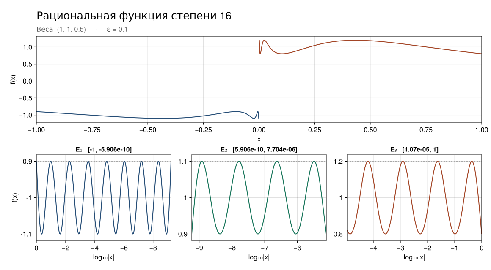

# Фильтры Золотарёва и Стифеля на Julia

Проект вычисляет рациональные фильтры через матрицы периодов и тета-функции. Исходное построение Стифеля переводит точки прямоугольника на якобиан кривой рода 2, проецирует их на сферу и собирает дробь по нулям и полюсам. [Математические обозначения и нормировка](docs/stiefel.md).

## Рациональная функция на трёх полосах

Программа строит три рабочих отрезка и вычисляет на них рациональную функцию степени `n` с целями `−1, +1, +1`. При положительных весах `w₁, w₂, w₃` допустимое отклонение на отрезке `Eⱼ` равно `ε/wⱼ`. Частичная склейка рассчитана на `w₂ ≠ w₃` и требует перекрытия контактных точек двух фаз. Для показанного примера взяты `n = 16`, `ε = 0.1` и веса `(1, 1, 0.5)`. Три панели снизу показывают 15, 7 и 8 внутренних экстремумов.



[Код построения дроби на Julia](src/three_bands/oscillating_threebands.jl) · [Вычисление её значений](src/three_bands/weighted_welding.jl) · [Скрипт для сохранения изображения](examples/three_bands/save_function.jl).

Для сохранения SVG и PNG из корня проекта выполните команды ниже. Первая устанавливает зависимости при первом запуске, включая CairoMakie. Во второй после степени и допуска передаются веса полос в порядке возрастания `x`.

```sh
julia --project=. -e 'using Pkg; Pkg.instantiate()'
julia --project=. examples/three_bands/save_function.jl 16 0.1 1 1 0.5
```

Файлы появятся в `output/rational-function-n16.svg` и `output/rational-function-n16.png`.

Интерактивный пример `julia --project=. examples/oscillating_threebands.jl 16 0.1` печатает шесть концов и сохраняет график в `output/oscillating_threebands.html`. Кнопки переключают три панели между самой дробью и взвешенной ошибкой в единицах `ε`. Чтобы увидеть по шесть полных колебаний на каждой полосе для степени миллион, укажите третий аргумент. Скрипт переходит к выбранным клеткам по их индексам.

```sh
julia --project=. examples/oscillating_threebands.jl 1000000 0.1 6
```

Для степеней, требующих координат BigFloat, график по умолчанию показывает по шесть периодов. Третий аргумент `all` строит все колебания. Это требует числа отсчётов и объёма памяти порядка `n`. [График для степени миллион](docs/three_bands/million.svg).

Для расчёта в одной точке достаточно двух вызовов после загрузки модуля.

```julia
include("src/four_bands/StiefelFourBands.jl")
using .StiefelFourBands
s = oscillating_threebands(1_000_000, 0.1)
welded_value(s, big"1e-400000")  # точка второй полосы
```

Функция `oscillating_threebands(n, ε; weights=(1,1,0.5), order=28)` сравнивает две склейки и возвращает концы полос в `s.ends`. Параметр `order` задаёт число мод Фурье на шве. Когда квадрат внешнего эллиптического модуля выходит из нормального диапазона Float64, физические координаты автоматически вычисляются в BigFloat. Для столь малых входных чисел используйте запись `big"…"`. Расчёт шва и фазы внутри клетки остаётся в Float64, поэтому точность фазы при очень больших степенях ограничена этой разрядностью. Проверка перекрытия контактов в программе численная. Для весов (1, 1, ½) теорема о выборе допуска и доказательство оптимальности приведены в [PDF с графиком](docs/three_bands/tri-polosy-mnogo-kolebanii.pdf).

## Фильтр на четырёх полосах

Из корня репозитория выполните:

```sh
julia --project=. examples/four_bands.jl
```

Пример использует только стандартную библиотеку Julia 1.11. В начале файла задаются высота клетки `τ`, степень `N`, уровни двух разрезов `M1, M2` и компоненты матрицы `Ω`. По ним строится фильтр рода 3 с целями `−1, +1, +1, +1`. Скрипт печатает полную матрицу периодов `p = im * Ω`, восемь концов полос и значение дроби в комплексной точке. График обеих дробей и их отклонений сохраняется в `output/four_bands.html` и открывается без подключения к сети.

При известной полной матрице используйте `filter_from_periods(τ, p; trims=(...), sides=(...))`, где `trims` — пара чисел, а `sides` — пара символов `:above` или `:below`. Оба аргумента можно опустить для нулевых обрезок. В базисе четырёхполосного примера первая строка вещественной матрицы равна `(τ/2) * [N, N-M1, N-M2]`. Для двух разрезов программа восстанавливает гиперэллиптическую кривую и проверяет совместимость периодов. Значение дроби вычисляется композицией координаты прямоугольника и эллиптической функции.

Фильтр можно также построить по файлу периодов или по восьми заданным концам.

```sh
julia --project=. bin/fourbands.jl periods data/four_bands/periods-g3.toml --plot four-bands.html
julia --project=. bin/fourbands.jl solve 3 -1 0 .10525 .10772 .35397 .37827 .94801 1 --plot four-bands.html
```

Для `solve` по умолчанию используется семейство рода 3. Восстановление численное и может не найти подходящую геометрию. Реализованные семейства других родов и их ограничения описаны в [обзоре](docs/four_bands/other_genera.md).

## Исходные примеры Стифеля

Для исходных скриптов установите зависимости один раз:

```sh
julia --project=. -e 'using Pkg; Pkg.instantiate()'
SHTIFFEL_PLOT_BACKEND=cairo julia --project=. examples/stiefel/normalized_filter.jl
```

| Каталог | Содержимое |
| --- | --- |
| `src/stiefel/` | Тета-функции, преобразования Зигеля, точки ветвления и дроби исходного проекта |
| `src/four_bands/` | Построение четырёхполосных фильтров по периодам или концам полос |
| `src/integration/`, `src/visualization/` | Интегрирование, поверхности и сечения |
| `examples/` | Запускаемые расчёты по тем же темам |
| `data/` | Опорные точки нормировки и параметры четырёхполосных примеров в TOML |
| `test/`, `tools/diagnostics/` | Численные проверки и диагностические скрипты |

Все численные проверки запускаются командой `julia --project=. test/runtests.jl`. Только четырёхполосные тесты запускаются командой `julia --project=. test/four_bands/runtests.jl`. Исходные автономные проверки запускаются отдельно: `julia test/stiefel/siegel_audit.jl` и `julia test/stiefel/surface_theta_log.jl`.
